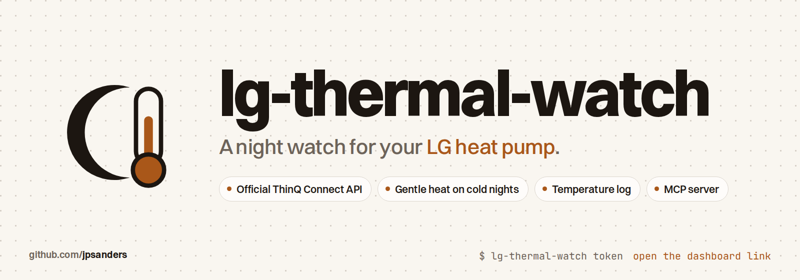

<p align="center">
  <picture>
    <source media="(prefers-color-scheme: dark)" srcset="docs/images/banner-dark.png">
    
  </picture>
</p>

<p align="center">
  <a href="https://github.com/jpsanders/lg-thermal-watch/actions/workflows/dev.yml"></a>
  <a href="https://github.com/jpsanders/lg-thermal-watch/releases/latest"></a>
  <a href="https://www.python.org/downloads/"></a>
  
  <a href="#with-an-ai-agent"></a>
  <a href="#with-an-ai-agent"></a>
  
  <a href="https://mypy-lang.org/"></a>
  <a href="LICENSE"></a>
  <a href="https://github.com/jpsanders/lg-thermal-watch/stargazers"></a>
</p>

A night watch, a temperature log and a dashboard for an LG heat pump, on LG's official ThinQ Connect API. When the
room gets cold at night it switches the unit on, heats gently to your target with the fan on LOW, and switches it off
again. In the meantime it logs the room every minute, counts every run, estimates the energy, and lets you, or your
AI agent, ask how warm it is.

```sh
uv tool install git+https://github.com/jpsanders/lg-thermal-watch@1.0.0
lg-thermal-watch            # with your LG_THINQ_* credentials in the environment
lg-thermal-watch token      # the dashboard link
```

## What it does

- **Night watch.** Below a low threshold inside a night window (00:00 to 07:00 by default, in a timezone you set), it
  powers the unit on, heats to a high target with the fan LOW, then switches off. Settings survive restarts.
- **Temperature log.** The room temperature every 60 seconds into SQLite, with min, max and mean over any window.
- **Runtime.** Every on and off run with its duration and source, night watch or manual, and an estimated monthly
  energy chart.
- **Dashboard.** The live temperature against the thresholds, what the watch is doing and why, a history chart with
  the nights and the heating runs marked, the settings, and manual heat and off.
- **Careful with the unit.** Commands are bounded and rate limited, and the unit only gets the settings it lacks.

Built for the LG PC18SK indoor unit; any ThinQ Connect air conditioner that reports a room temperature should work.

## How it works

```text
LG ThinQ Connect API
        |
LGPC18SKAgent  <-  ThinQAgentController  <-  thinqconnect SDK
        |
        +--> LGPC18SKNightWatch   gentle heat when cold
        +--> RoomTempLogger       SQLite
        +--> RuntimeTracker       runs and energy
                |
          FastAPI /api, behind a token  -->  dashboard   -->  MCP server for agents
```

## Install and run

You need an LG account with the unit in the ThinQ app, and a ThinQ Connect personal access token from LG's developer
site. Put the credentials in an environment file with mode 600:

```sh
# ~/.config/lg-thermal-watch/lg-thermal-watch.env
LG_THINQ_ACCESS_TOKEN=...
LG_THINQ_CLIENT_ID=...
LG_THINQ_COUNTRY_CODE=PT
LG_THINQ_DEVICE_ID=...
LG_THERMAL_WATCH_TIMEZONE=Europe/Lisbon
```

Then run it as a systemd user service, so a reboot needs no manual step:

```ini
# ~/.config/systemd/user/lg-thermal-watch.service
[Unit]
Description=LG Thermal Watch

[Service]
EnvironmentFile=%h/.config/lg-thermal-watch/lg-thermal-watch.env
ExecStart=%h/.local/bin/lg-thermal-watch
Restart=always
RestartSec=10

[Install]
WantedBy=default.target
```

```sh
systemctl --user enable --now lg-thermal-watch
lg-thermal-watch token      # open the link it prints, once per browser
```

User services stop when you log out unless lingering is on: `loginctl enable-linger`.

## Secure by default

Every API call except the health check needs a token. The dashboard link stores it in an HttpOnly, SameSite=Strict
cookie, so other sites in your browser can neither read it nor send requests that switch the unit, and requests that
name a host your machine does not answer to are refused. It listens on 127.0.0.1 unless you say otherwise.

To reach it from your phone over Tailscale, listen on the Tailscale address only, which keeps the port off your local
network: `LG_THERMAL_WATCH_HOST=$(tailscale ip -4)`. Then open `http://<tailscale-ip>:8000/?token=...` once. Never
expose the port to the internet.

## With an AI agent

lg-thermal-watch is a Claude Code plugin: a skill with the rules, and an MCP server that talks to your running service
with the same token. Ask "how cold did the living room get last night?" or "warm the room to 21".

```text
/plugin install lg-thermal-watch --marketplace jpsanders/lg-thermal-watch
```

On Claude Code before 2.1.275: `/plugin marketplace add jpsanders/lg-thermal-watch`, then
`/plugin install lg-thermal-watch@lg-thermal-watch`. Any MCP client can run the server directly:

```json
{"mcpServers": {"lg-thermal-watch": {"command": "lg-thermal-watch", "args": ["mcp"]}}}
```

`status`, `temperatures` and `runtime` only read. `heat`, `off` and the three night watch tools act on a real heat
pump, so they are marked destructive and your harness asks before calling them.

## Configuration

| Variable | Meaning |
| --- | --- |
| `LG_THINQ_ACCESS_TOKEN`, `LG_THINQ_CLIENT_ID`, `LG_THINQ_COUNTRY_CODE` | ThinQ Connect credentials. Required. |
| `LG_THINQ_DEVICE_ID` | The unit's device id. |
| `LG_THERMAL_WATCH_HOST`, `LG_THERMAL_WATCH_PORT` | Where to listen. Default `127.0.0.1:8000`. |
| `LG_THERMAL_WATCH_TOKEN` | The API token. Default: generated once into `~/.local/state/lg-thermal-watch/token`. |
| `LG_THERMAL_WATCH_TIMEZONE` | IANA zone of the night window, such as `Europe/Lisbon`. |
| `LG_THERMAL_WATCH_DB` | SQLite file. Default `~/.local/share/lg-thermal-watch/room_temps.db`. |
| `LG_THERMAL_WATCH_NIGHTWATCH_CONFIG` | Night watch settings. Default `~/.config/lg-thermal-watch/nightwatch.json`. |
| `LG_THERMAL_WATCH_AVG_POWER_KW` | Assumed draw while running, for the energy estimate. Default `1.0`. |

The full list, the API and the night watch settings are in the manual: `lg-thermal-watch guide`, `lg-thermal-watch man`
or [`docs/MANUAL.md`](docs/MANUAL.md). `lg-thermal-watch man --install` makes `man lg-thermal-watch` work.

## Develop

```sh
make init-dev
make checks
```

`make checks` runs isort, black, editorconfig-checker, darglint, flake8, mypy in strict mode, bandit, the man page
check and pytest with coverage. Tests use a mock unit and never talk to LG. CI runs them on Python 3.14 and 3.15 on
Linux and macOS, then installs the wheel, starts the service and checks that a call without the token is refused.
See [CONTRIBUTING.md](CONTRIBUTING.md) and [AGENTS.md](AGENTS.md).

## Star history

<a href="https://star-history.com/#jpsanders/lg-thermal-watch&Date">
  <picture>
    <source media="(prefers-color-scheme: dark)" srcset="https://api.star-history.com/svg?repos=jpsanders/lg-thermal-watch&type=Date&theme=dark">
    
  </picture>
</a>

## Licence

MIT. Made by [James Phillip Sanders](https://jamesphillipsanders.com). LG and ThinQ are trademarks of LG Electronics;
this project is not made or endorsed by LG.
